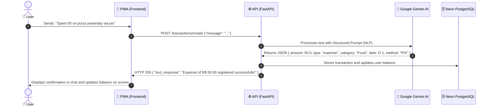
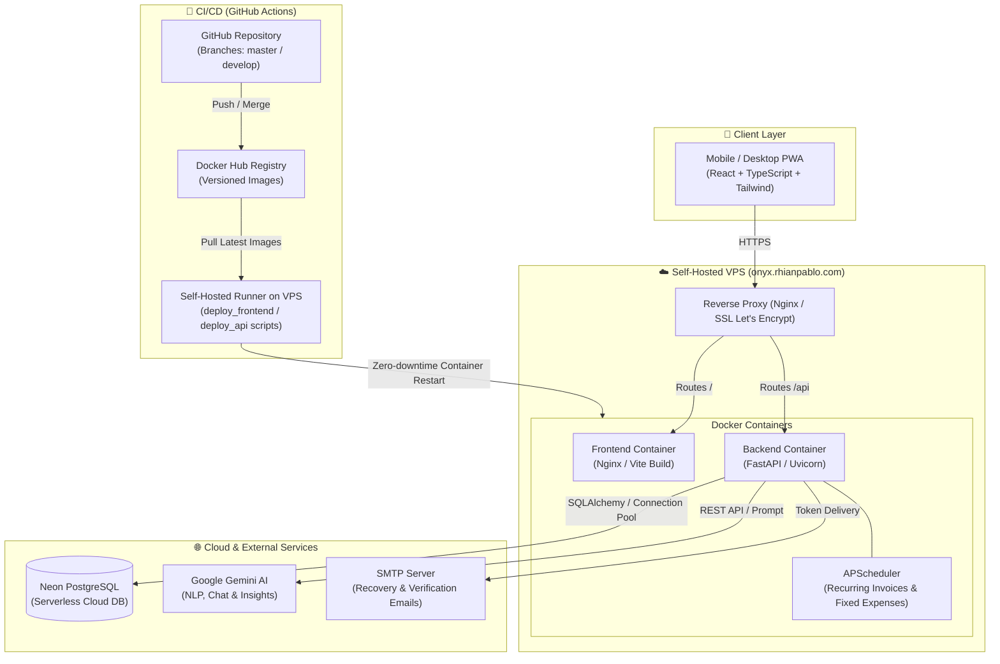
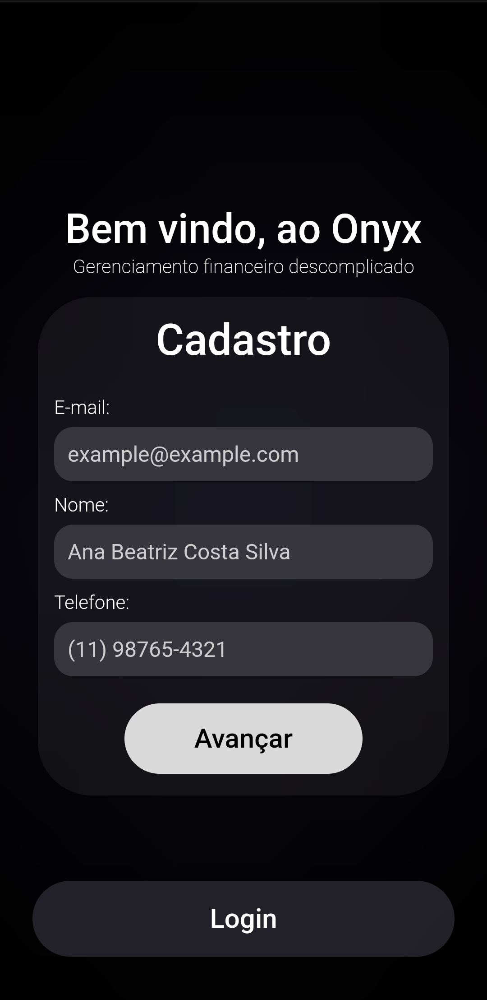
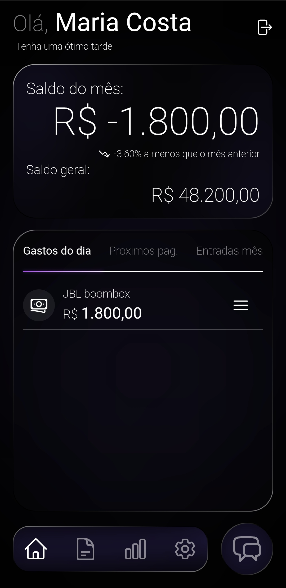
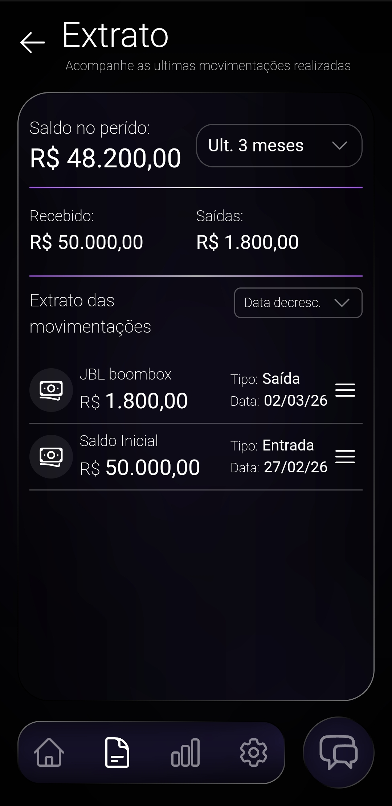
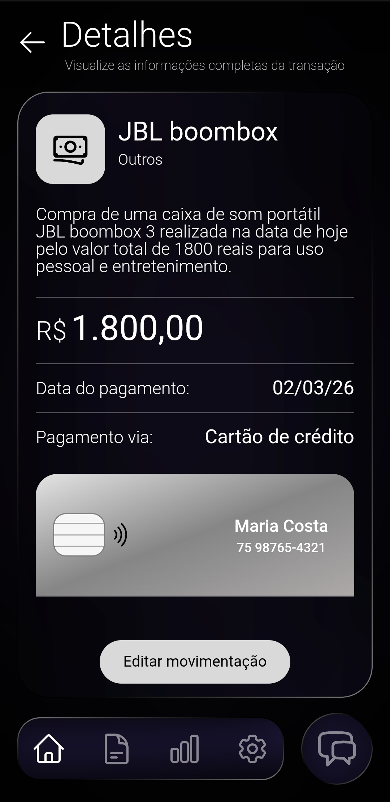

# 💎 Onyx - Finance Management

<div align="center">
  
  
  <p><strong>Smart, modern, and secure financial management.</strong></p>

  <p>To try the application, visit: <strong><a style='color: violet;' href='https://onyx.rhianpablo.com'>onyx.rhianpablo.com</a></strong></p>

  <p>
    <a href="./README.md">🇧🇷 Versão em Português</a> •
    <a href="./README.en.md"><strong>🇺🇸 English Version</strong></a>
  </p>

  
  
  
  
  
  
  
</div>

<br/>

> [!TIP]
> ### 🧪 Demo Account for Immediate Testing
> To explore the application without having to register a new account or set up biometrics, use the following credentials on the standard login screen:
> - **Access URL:** [onyx.rhianpablo.com](https://onyx.rhianpablo.com)
> - **Email:** `example@example.com`
> - **Password:** `1`

<br/>

## 📋 Table of Contents
 - [About the Project](#about-the-project)
 - [Demo Account](#demo-account)
 - [Project Status](#project-status)
 - [Key Features](#key-features)
 - [AI ChatBot Flow (Demonstration)](#ai-chatbot-flow)
 - [Architecture Diagram](#architecture-diagram)
 - [Technical Decisions & Trade-offs](#technical-decisions)
 - [Automated Testing Strategy](#automated-tests)
 - [Known Limitations & Roadmap](#limitations-and-roadmap)
 - [Technologies Used](#technologies-used)
 - [Project Structure](#project-structure)
 - [Hosting & Infrastructure](#hosting)
 - [CI/CD & Docker Images](#cicd)
 - [How to Run Locally](#how-to-run-locally)
 - [Screenshots](#screenshots)
 - [Author](#author)

---

## <a id="about-the-project"></a>📖 About the Project

**Onyx - Finance Management** is a modern Full-Stack personal finance application designed to provide a frictionless, secure, and intelligent user experience. Combining contemporary design with robust architectural patterns, the system allows users to record transactions without cumbersome forms — either through an intuitive manual wizard or via natural language commands handled by an integrated AI ChatBot.

The project also eliminates the friction of traditional passwords by offering native biometric authentication via **WebAuthn (Passkeys, FaceID, TouchID)**, alongside email-based recovery and standard JWT-authenticated fallback access.

---

## <a id="demo-account"></a>🔑 Demo Account

To test all production features immediately without creating a new user:

| Parameter | Value |
| :--- | :--- |
| **Access URL** | [https://onyx.rhianpablo.com](https://onyx.rhianpablo.com) |
| **Email** | `example@example.com` |
| **Password** | `1` |

> *Upon logging in, you'll have immediate access to the Dashboard with sample transactions, Statement/History, manual transaction creator, and the AI ChatBot.*

---

## <a id="project-status"></a>🚧 Project Status

**In active production and continuous development.** The application is live under the domain [onyx.rhianpablo.com](https://onyx.rhianpablo.com), backed by automated CI/CD pipelines, cloud database persistence, and regular updates to both the UI and AI integrations.

---

## <a id="key-features"></a>✨ Key Features

* **🔐 Passwordless & Biometric Authentication:** Secure biometric login via WebAuthn (Passkeys / FaceID / TouchID) plus JWT-protected sessions.
* **🤖 Conversational AI ChatBot:** Natural language processing via Google Gemini AI to automatically categorize and record expenses and income from everyday messages.
* **➕ Manual Entry & Categories:** Granular control to create and manage one-off, installment, or recurring transactions organized by category.
* **📊 Real-Time Dynamic Dashboard:** Instant visibility of current balance, daily expenses, total income, monthly expenditure, and pending invoices.
* **💡 Smart Financial Insights:** AI-generated observations and suggestions based on individual spending habits.
* **🧾 Detailed Financial Statement:** Comprehensive transaction history with search, category/period filtering, and drill-down transaction details.
* **📱 Progressive Web App (PWA):** Easily installable on mobile devices and desktops, featuring native-like performance and responsive design.

---

## <a id="ai-chatbot-flow"></a>🤖 AI ChatBot Flow (Demonstration)

One of the primary pain points in personal financial tracking is the discipline required to fill out complex forms. In Onyx, recording a purchase is as simple as sending a quick text message:

<div align="center">
  
  <p><em>Example of the conversational flow: "Spent 50 on pizza yesterday via pix"</em></p>
</div>

### Processing Flow:



### Real-world Extraction Example:

* **User Input:** *"Pedi uma pizza no ifood de 45 e 90 no pix ontem"* (*"Ordered pizza on iFood for 45.90 via PIX yesterday"*)
* **Structured Extraction:**
  * **Amount:** `R$ 45.90`
  * **Type:** `Expense`
  * **Category:** `Food`
  * **Payment Method:** `PIX`
  * **Date:** Yesterday's date, accurately inferred based on server timezone
  * **Description:** `Ifood Pizza`
* **Hallucination & Invalid Input Handling:** If the user inputs non-financial text (e.g. *"flying zucchini"*), the AI prompt instructions return `None` and the backend responds gracefully without corrupting database records.

---

## <a id="architecture-diagram"></a>📐 Architecture Diagram

The diagram below details the interaction between the PWA client, production VPS hosting, cloud services (Neon and Gemini), and the CI/CD pipeline:



---

## <a id="technical-decisions"></a>🧠 Technical Decisions & Trade-offs

| Architectural Decision | Considered Alternatives | Motivation & Trade-offs |
| :--- | :--- | :--- |
| **FastAPI + Pydantic** | Django, Flask, Express/Node.js | **Choice:** High asynchronous performance (`asyncio`), strict payload validation with Pydantic schemas, and out-of-the-box OpenAPI (Swagger) documentation. **Trade-off:** Less "batteries-included" than Django, requiring explicit service and controller architecture. |
| **WebAuthn (Passkeys) + JWT Fallback** | Password-only authentication | **Choice:** Eliminates phishing and credential-stuffing vulnerabilities, providing single-tap FaceID/TouchID authentication on modern devices. Retains standard email/password with Bcrypt hashing for compatibility and testing (e.g. demo account). |
| **Google Gemini AI for NLP** | Regex, SpaCy, Rasa | **Choice:** Regular expressions break easily on colloquial Brazilian Portuguese (*"cinquenta conto no podrão"*). Generative models understand temporal nuances ("yesterday", "last Friday") and intent without needing bespoke model training. |
| **Neon PostgreSQL Serverless** | Local Docker Postgres, SQLite, AWS RDS | **Choice:** Separation of compute and storage, zero database maintenance overhead, automatic continuous backups, and high availability without consuming VPS memory resources. |
| **Self-Hosted VPS with Docker** | PaaS (Netlify, Koyeb, Render, Vercel) | **Choice:** Eliminates cold start latency from free tiers, keeps everything under a unified custom domain (`onyx.rhianpablo.com`) without cross-service redirects, reduces long-term operational cost, and gives full control over networks and proxies. |
| **Progressive Web App (PWA)** | Separate Native Apps (Swift / Kotlin / React Native) | **Choice:** Single codebase in React/TypeScript, allowing users to install the app straight from the browser without store fees, platform fragmentation, or app store review delays. |

---

## <a id="automated-tests"></a>🧪 Automated Testing Strategy

The project features a comprehensive automated test suite (50+ tests) ensuring financial precision, AI resilience, and endpoint security:

### Implemented Test Suites (`app/tests`):

1. **Unit & AI Processor Tests (`test_ai.py`):**
   - **Happy Path:** Validates that realistic messages (e.g. *"Pedi uma pizza no ifood de 45 e 90 no pix"*) generate valid JSON payloads and persist with accurate values, categories, and payment methods.
   - **Fault Tolerance & Hallucination Handling:** Ensures the system cleanly handles null responses or non-financial inputs (*"abobrinha voadora"*) without saving corrupt data.
2. **API Integration & Security Tests (`test_api.py`):**
   - **Security:** Verifies HTTP 401 Unauthorized enforcement on protected routes when tokens are missing.
   - **Financial Calculations:** Employs `freezegun` to freeze time and verify that total expenses, income, and period balance match exact mathematical expectations.
3. **Manual Entry & Business Logic Tests (`test_create_manual.py`):**
   - Immediate simple expenses (verifying real-time balance deductions).
   - Future, recurring, and installment-based expenses.
4. **Edit & Deletion Integrity Tests (`test_edit_transactions.py` & `test_delete.py`):**
   - Balance recalculations when altering past dates or amounts.
   - Cascade operations, future-only cancellations, and balance refunds upon deletion.
5. **State Synchronization Tests (`test_sync.py`):**
   - Edge cases for leap years, end-of-year transitions, zero-division guards, and multi-month inactivity catches.
6. **CI/CD Smoke Tests (`test-build.yaml`):**
   - Spawns fresh Docker Compose instances for every Pull Request targeting `develop`.
   - Performs endpoint health checks via `curl` and executes the full `pytest` suite inside the container before merge approval.

### Running Tests Locally:

```bash
# Inside the Docker container (recommended):
docker compose exec backend pytest -v

# Or via your local virtual environment:
pytest app/tests -v
```

---

## <a id="limitations-and-roadmap"></a>⚠️ Known Limitations & Roadmap

### Current Limitations:
* **AI API Latency & Quotas:** ChatBot response latency depends on Google Gemini API inference times and rate limits.
* **Single Currency:** The application is calibrated specifically for Brazilian Real (BRL / R$).
* **No Direct Open Finance Banking Integration:** Transactions are logged manually or via the ChatBot; direct account-aggregation APIs are not yet integrated.
* **Limited Offline Capability:** While the PWA assets are cached, NLP processing and real-time database sync require an active internet connection.

### Planned Roadmap:
- [ ] **Multimodal Receipt & PIX OCR:** Upload photos of receipts or PIX payment screenshots for automated extraction using Gemini Vision.
- [ ] **Open Finance Brasil Integration:** Automated balance and transaction sync with Brazilian banking institutions.
- [ ] **Push Notifications:** Configurable device alerts for upcoming bill due dates and category budget limits.
- [ ] **Data Export:** Export financial statements in PDF and CSV/Excel formats.

---

## <a id="technologies-used"></a>💻 Technologies Used

### Frontend
* **React (TypeScript):** Component-based UI with static typing and high maintainability.
* **Tailwind CSS:** Modern utility-first styling for responsive layouts.
* **Vite & Vite PWA:** Lightning-fast builds and complete Progressive Web App capabilities.
* **Axios:** Robust HTTP client for API interaction.

### Backend
* **FastAPI:** High-performance asynchronous Python web framework for RESTful APIs.
* **SQLAlchemy & Alembic:** ORM and database migrations management.
* **PostgreSQL:** Reliable relational database for structured financial records.
* **WebAuthn / FIDO2:** Secure passwordless biometric authentication standard.
* **JWT & Passlib / Bcrypt:** Secure token management and password hashing.
* **Google Gemini AI:** Generative AI for NLP-driven transaction parsing and financial insights.
* **APScheduler:** In-process background scheduler for recurring tasks and invoice lifecycle management.

### DevOps & Infrastructure
* **Docker & Docker Compose:** Consistent containerization across local and production environments.
* **Self-Hosted VPS:** Dedicated cloud server running Frontend and Backend containers under a custom domain.
* **Neon PostgreSQL:** Serverless PostgreSQL database with automated backups and branchable storage.
* **GitHub Actions:** CI/CD automation for testing, Docker Hub image publishing, and automated VPS deployment via self-hosted runner.

---

## <a id="project-structure"></a>🏗 Project Structure

### Frontend (`/front-end-app`)
* **`assets/`:** Static images, logos, and illustration assets.
* **`components/`:** Reusable UI components (buttons, cards, modals, input fields).
* **`hooks/`:** Custom React hooks for data fetching, auth, and state logic.
* **`interfaces/`:** TypeScript type definitions and API contracts.
* **`layouts/`:** Structural layout wrappers (Dashboard, History) using `<Outlet />`.
* **`pages/`:** View screens (Login, Register, Dashboard, History, Chat, Add Transaction, etc.).
* **`routes/`:** Public and protected routing definitions.
* **`services/`:** Axios client instances, header interceptors, cookies, and token storage.
* **`utils/`:** Utility formatters (currency BRL, date manipulation, input masks).

### Backend (`/app`)
* **`controllers/`:** Business logic and entity CRUD orchestration.
* **`core/`:** Core configs, database connection factories, and environment variables.
* **`models/`:** SQLAlchemy relational table models.
* **`routers/`:** REST API endpoints grouped by domain (users, transactions, chat, insights).
* **`schemas/`:** Pydantic models for request validation and response serialization.
* **`services/`:** External integrations (Google Gemini AI, email dispatch, scheduled tasks).
* **`tests/`:** Automated test suite with `pytest` (unit, integration, and AI mocks).
* **`utils/`:** Security helpers, date calculations, and auxiliary methods.

---

## <a id="hosting"></a>☁️ Hosting & Infrastructure

The production environment is architected for stability, low overhead, and straightforward maintenance:

* **VPS (Virtual Private Server):** Production environment hosting containerized Frontend and Backend instances under the custom domain: **[onyx.rhianpablo.com](https://onyx.rhianpablo.com)**.
* **[Neon](https://neon.tech/):** Serverless PostgreSQL cloud database providing high availability, fast queries, and reliable data persistence.

---

## <a id="cicd"></a>⚙️ CI/CD & Docker Images

Continuous integration and continuous deployment are managed through **GitHub Actions**:

### Implemented Workflows:
1. **Smoke Tests & Integration Pipeline:**
   - Every Pull Request to `develop` spins up a containerized Docker environment.
   - Health checks verify backend and frontend responsiveness.
   - The full `pytest` suite runs inside the backend container to prevent regression merges.

2. **Automated VPS Deployment:**
   - When code is merged into `master`, build workflows publish new tagged images to Docker Hub.
   - A self-hosted runner on the VPS pulls the latest image and updates running containers with zero downtime using deployment scripts (`deploy_frontend.sh` and `deploy_api.sh`).

### Docker Hub Repositories:
Pre-built container images are publicly available on Docker Hub:
* 🌐 **Frontend:** [`docker pull rhianpablo11/finance-management-frontend`](https://hub.docker.com/r/rhianpablo11/finance-management-frontend)
* ⚙️ **Backend:** [`docker pull rhianpablo11/finance-management-backend`](https://hub.docker.com/r/rhianpablo11/finance-management-backend)

---

## <a id="how-to-run-locally"></a>🚀 How to Run Locally

You can spin up the complete environment locally using Docker Compose:

### Prerequisites
* [Docker](https://www.docker.com/) installed
* [Docker Compose](https://docs.docker.com/compose/)

### Step-by-Step

1. **Clone the repository:**
   ```bash
   git clone https://github.com/rhianpablo11/onyx_finance_management.git
   cd onyx_finance_management
   ```

2. **Configure Environment Variables:**
   Review and adjust the environment variables inside `docker-compose.yaml`:
   * `GEMINI_API_KEY`: Google Gemini API key for the ChatBot and Insights.
   * `ADDRESS_EMAIL` and `PASSWORD_EMAIL`: SMTP credentials for verification/recovery emails.
   * `BIOMETRIC_RP_ID` and `BIOMETRIC_ORIGIN`: Domain and origin settings for WebAuthn (local defaults: `localhost` and `http://localhost:5173`).
   * `ORIGINS_ALLOWED`: Allowed origins for CORS.

3. **Start the Containers:**
   ```bash
   docker compose up --build
   ```
   *The backend will automatically create tables and initialize the database on first run.*

4. **Access in Your Browser:**
   * **Frontend:** [http://localhost:5173](http://localhost:5173)
   * **Swagger API Docs:** [http://localhost:8000/docs](http://localhost:8000/docs)

---

## <a id="screenshots"></a>🎨 Screenshots

<div align="center">
  
  
  
</div>

<div align="center">
  
  
  
  
</div>

---

## <a id="author"></a>👨‍💻 Author

Developed by **[Rhian Pablo](https://www.linkedin.com/in/rhianpablo11/)**  
Computer Engineering Student at Universidade Estadual de Feira de Santana (UEFS).

