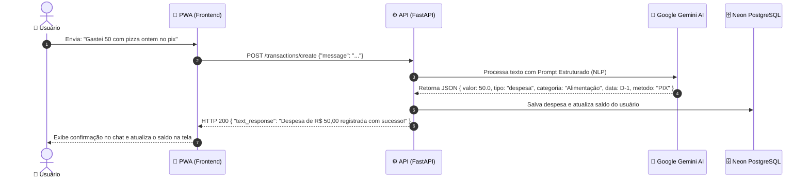
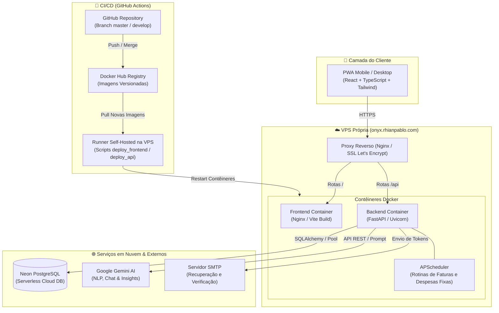
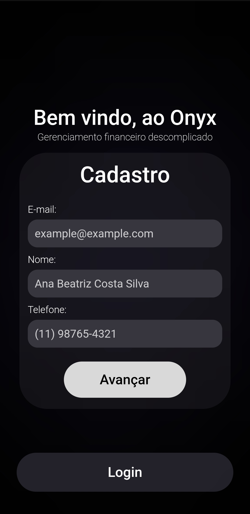
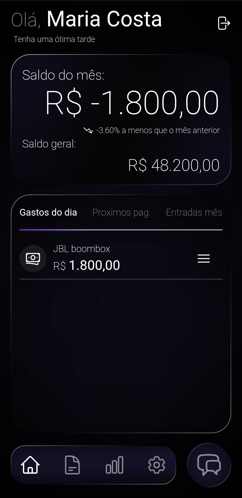
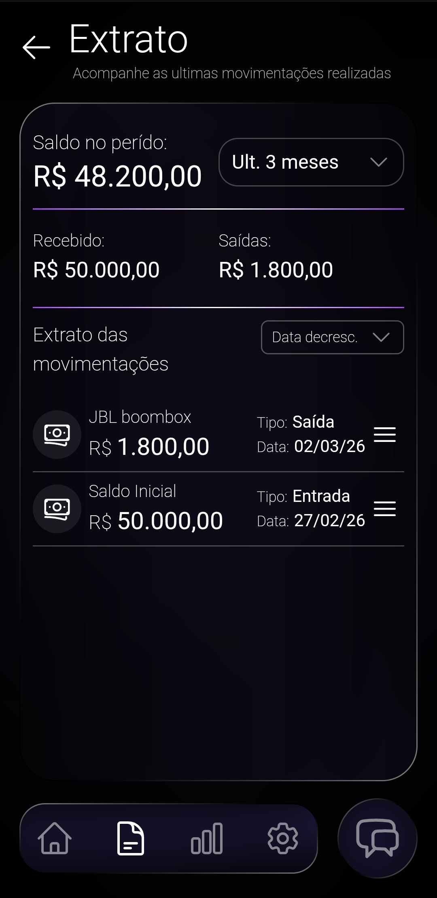
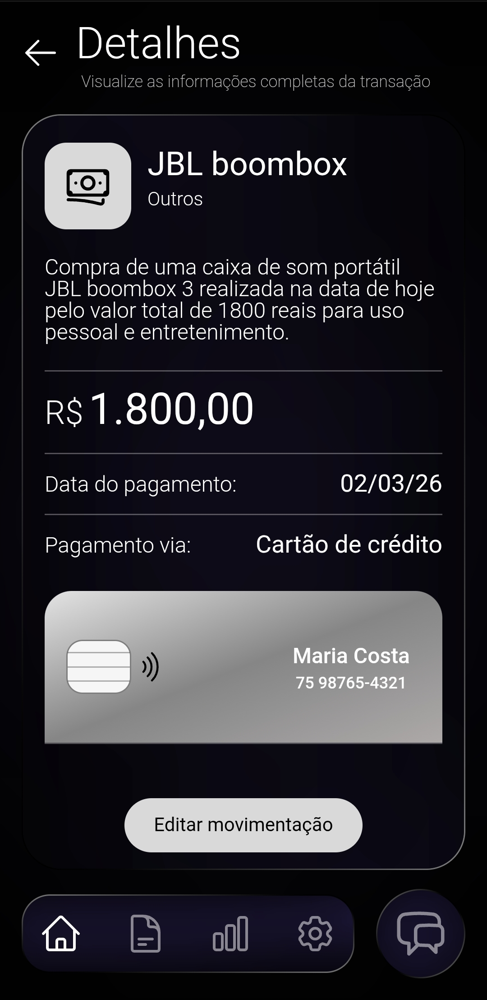

# 💎 Onyx - Finance Management

<div align="center">
  
  
  <p><strong>Gestão financeira inteligente, moderna e segura.</strong></p>

  <p>Para utilizar a aplicação, basta acessar: <strong><a style='color: violet;' href='https://onyx.rhianpablo.com'>onyx.rhianpablo.com</a></strong></p>

  
  
  
  
  
  
  
</div>

<br/>

> [!TIP]
> ### 🧪 Conta Demo para Testes Imediatos
> Para explorar a aplicação sem a necessidade de criar uma nova conta ou cadastrar biometria, utilize as seguintes credenciais na tela de login tradicional:
> - **URL de Acesso:** [onyx.rhianpablo.com](https://onyx.rhianpablo.com)
> - **E-mail:** `example@example.com`
> - **Senha:** `1`

<br/>

## 📋 Índice
 - [Sobre o Projeto](#sobre-o-projeto)
 - [Conta Demo](#conta-demo)
 - [Status do Projeto](#status-do-projeto)
 - [Principais Funcionalidades](#principais-funcionalidades)
 - [Fluxo do ChatBot com IA (Demonstração)](#fluxo-do-chatbot)
 - [Diagrama de Arquitetura](#diagrama-de-arquitetura)
 - [Decisões Técnicas e Trade-offs](#decisoes-tecnicas)
 - [Estratégia de Testes Automatizados](#testes-automatizados)
 - [Limitações e Roadmap](#limitacoes-e-roadmap)
 - [Tecnologias Utilizadas](#tecnologias-utilizadas)
 - [Estrutura do Projeto](#estrutura-do-projeto)
 - [Hospedagem e Infraestrutura](#hospedagem)
 - [CI/CD e Imagens Docker](#cicd)
 - [Como Executar Localmente](#como-executar-localmente)
 - [Screenshots](#screenshots)
 - [Autor](#autor)

---

## <a id="sobre-o-projeto"></a>📖 Sobre o Projeto

O **Onyx - Finance Management** é uma aplicação Full-Stack de gerenciamento financeiro pessoal projetada para oferecer uma experiência ágil, segura e inteligente. Combinando um design moderno a uma arquitetura robusta, o sistema permite registrar transações sem atrito — seja preenchendo rapidamente de forma manual ou utilizando comandos em linguagem natural através do ChatBot inteligente integrado com IA.

O projeto também inova ao eliminar a dependência exclusiva de senhas tradicionais, contando com autenticação biométrica nativa via **WebAuthn (Passkeys, FaceID, TouchID)**, além de suporte a fluxo seguro de recuperação de acesso por e-mail e autenticação convencional com JWT.

---

## <a id="conta-demo"></a>🔑 Conta Demo

Para testar todas as funcionalidades do sistema em produção sem precisar realizar um novo cadastro:

| Parâmetro | Valor |
| :--- | :--- |
| **Acesso** | [https://onyx.rhianpablo.com](https://onyx.rhianpablo.com) |
| **E-mail** | `example@example.com` |
| **Senha** | `1` |

> *Ao entrar, você terá acesso imediato ao Dashboard com dados de movimentações, Extrato, cadastro de transações manuais e ao ChatBot integrado.*

---

## <a id="status-do-projeto"></a>🚧 Status do Projeto

**Em produção e evolução ativa.** A aplicação está no ar sob o domínio [onyx.rhianpablo.com](https://onyx.rhianpablo.com), contando com esteira de CI/CD automatizada, banco em nuvem e melhorias contínuas tanto na interface quanto nas integrações de inteligência artificial.

---

## <a id="principais-funcionalidades"></a>✨ Principais Funcionalidades

* **🔐 Autenticação Biométrica (WebAuthn / Passkeys):** Login sem senhas via FaceID/TouchID, reduzindo atrito e aumentando a segurança contra phishing.
* **🤖 ChatBot Conversacional com IA:** Registro automático de gastos e receitas a partir de mensagens coloquiais em português brasileiro.
* **➕ Lançamento Manual e Categorias:** Controle completo para criação e edição de despesas/receitas únicas, parceladas ou recorrentes.
* **📊 Dashboard Dinâmico em Tempo Real:** Resumo do saldo atual, gastos do dia, total de receitas, despesas do mês e faturas pendentes.
* **💡 Insights Financeiros Inteligentes:** Análise contextual gerada por IA sobre os padrões de consumo do usuário.
* **🧾 Extrato Detalhado com Filtros:** Filtros por período, tipo de operação e categoria, com busca e detalhes da transação.
* **📱 Progressive Web App (PWA):** Instalação facilitada em dispositivos móveis e desktops, com interface responsiva e comportamento de app nativo.

---

## <a id="fluxo-do-chatbot"></a>🤖 Fluxo do ChatBot com IA (Demonstração)

Uma das maiores dores no controle financeiro pessoal é a disciplina de preencher formulários extensos. No Onyx, o registro de um gasto pode ser feito com uma simples mensagem:

<div align="center">
  
  <p><em>Exemplo do fluxo conversacional em tempo real: "Gastei 50 com pizza ontem no pix"</em></p>
</div>

### Como funciona o processamento:



### Exemplo Prático de Extração:

* **Entrada do Usuário:** *"Pedi uma pizza no ifood de 45 e 90 no pix ontem"*
* **Extração Estruturada:**
  * **Valor:** `R$ 45,90`
  * **Tipo:** `Despesa`
  * **Categoria:** `Alimentação`
  * **Método de Pagamento:** `PIX`
  * **Data:** Data de ontem calculada com base no fuso horário do servidor
  * **Descrição:** `Ifood Pizza`
* **Tratamento de Alucinações / Entradas Inválidas:** Se o usuário digitar algo fora do domínio financeiro (ex.: *"abobrinha voadora"*), a IA é instruída a retornar `None` e o backend responde de forma amigável sem poluir o banco de dados.

---

## <a id="diagrama-de-arquitetura"></a>📐 Diagrama de Arquitetura

O diagrama abaixo ilustra a integração entre o cliente PWA, o servidor em produção na VPS, os serviços em nuvem (Neon e Gemini) e a esteira de CI/CD:



---

## <a id="decisoes-tecnicas"></a>🧠 Decisões Técnicas e Trade-offs

| Decisão Arquitetural | Alternativas Consideradas | Motivação & Trade-offs |
| :--- | :--- | :--- |
| **FastAPI + Pydantic** | Django, Flask, Express/Node.js | **Escolha:** Alta performance assíncrona (`asyncio`), validação rigorosa de payloads via tipagem Pydantic e geração automática de documentação Swagger. **Trade-off:** Menor ecossistema de "baterias inclusas" que o Django, exigindo arquitetura manual de serviços e controllers. |
| **WebAuthn (Passkeys) + Fallback JWT** | Autenticação padrão apenas por senha | **Escolha:** Elimina o risco de senhas vazadas e ataques de força bruta/phishing, permitindo login instantâneo com FaceID/TouchID no smartphone. Mantivemos o fallback tradicional por e-mail/senha com Bcrypt para compatibilidade e testes (ex: conta demo). |
| **Google Gemini AI para NLP** | Expressões Regulares (RegEx), SpaCy, Rasa | **Escolha:** RegEx é extremamente frágil para linguagem coloquial brasileira (*"gastei cinquenta conto no podrão"*). Modelos generativos compreendem contexto temporal ("ontem", "anteontem") e intenção sem demandar treinamento contínuo de datasets próprios. |
| **Neon PostgreSQL Serverless** | PostgreSQL local no Docker, SQLite, AWS RDS | **Escolha:** Separação entre computação e armazenamento, zero manutenção de infraestrutura de banco, backups contínuos e alta confiabilidade, sem consumir recursos de memória da VPS. |
| **VPS Própria com Docker** | PaaS (Netlify, Koyeb, Render, Vercel) | **Escolha:** Eliminação dos *cold starts* das instâncias gratuitas, domínio unificado (`onyx.rhianpablo.com`) sem redirecionamentos entre múltiplos provedores, menor custo operacional a longo prazo e total controle sobre redes e proxies. |
| **PWA (Progressive Web App)** | Aplicativos nativos separados (Swift / Kotlin / React Native) | **Escolha:** Única base de código em React/TypeScript, permitindo que o usuário instale o app direto pelo navegador sem a burocracia, taxas e tempo de aprovação das lojas Apple App Store e Google Play. |

---

## <a id="testes-automatizados"></a>🧪 Estratégia de Testes Automatizados

O projeto conta com uma suíte de testes automatizados com foco em garantir a integridade dos cálculos financeiros, a robustez da inteligência artificial e a segurança das rotas:

### Camadas de Testes Implementadas (`app/tests`):

1. **Testes Unitários & IA (`test_ai.py`):**
   - **Caminho Feliz:** Garante que mensagens reais (ex: *"Pedi uma pizza no ifood de 45 e 90 no pix"*) gerem payloads válidos e salvem no banco de dados com valores, métodos e datas exatas.
   - **Resiliência a Falhas & Alucinações:** Verifica se o sistema trata adequadamente respostas nulas ou mensagens sem sentido (*"abobrinha voadora"*), retornando mensagens amigáveis sem corromper o banco.
2. **Testes de Integração & Segurança (`test_api.py`):**
   - **Autenticação:** Validação de bloqueio com HTTP 401 para requisições não autenticadas em rotas privadas.
   - **Cálculo de Extratos:** Uso de `freezegun` para congelar datas e validar se o somatório de despesas, receitas e balanço final do período está matematicamente exato.
3. **Testes de Criação Manual & Regras de Negócio (`test_create_manual.py`):**
   - Criação de despesas simples imediatas (verificando o débito no saldo).
   - Criação de despesas futuras, recorrentes e parceladas.
4. **Testes de Edição e Exclusão (`test_edit_transactions.py` e `test_delete.py`):**
   - Recálculo de saldo ao alterar valores ou datas de transações passadas.
   - Remoção de transações e garantia de integridade referencial.
5. **Testes de Sincronização (`test_sync.py`):**
   - Consistência de estados entre chamadas simultâneas.
6. **Smoke Tests no CI/CD (`test-build.yaml`):**
   - Inicialização completa dos contêineres Docker via Docker Compose a cada Pull Request para `develop`.
   - Verificação de disponibilidade dos endpoints de saúde (`/health`, `/docs` e Frontend).
   - Execução completa da suíte `pytest` dentro do contêiner antes de permitir o merge.

### Como Executar os Testes Localmente:

```bash
# Executando dentro do contêiner Docker (recomendado):
docker compose exec backend pytest -v

# Ou diretamente pelo ambiente virtual local:
pytest app/tests -v
```

---

## <a id="limitacoes-e-roadmap"></a>⚠️ Limitações Conhecidas e Roadmap

### Limitações Atuais:
* **Cotas e Latência da API de IA:** O tempo de resposta do ChatBot depende do tempo de inferência e dos rate limits da API do Google Gemini.
* **Moeda Única:** O sistema foi projetado e calibrado exclusivamente para transações em Real Brasileiro (BRL / R$).
* **Ausência de Integração Bancária Direta (Open Finance):** O registro de transações depende da inserção manual ou via ChatBot, sem leitura automática de extratos bancários de instituições financeiras via API.
* **Operação Offline Limitada:** Embora a interface PWA seja instalável e possua cache, o processamento de linguagem natural e a sincronização do banco exigem conexão com a internet.


---

## <a id="tecnologias-utilizadas"></a>💻 Tecnologias Utilizadas

### Frontend
* **React (TypeScript):** Componentização declarativa, tipagem estática e alta escalabilidade.
* **Tailwind CSS:** Design responsivo, moderno e de alta produtividade.
* **Vite & Vite PWA:** Build ultrarrápido e suporte completo a Progressive Web App (PWA).
* **Axios:** Cliente HTTP para comunicação eficiente com o backend.

### Backend
* **FastAPI:** Framework Python assíncrono de altíssimo desempenho para APIs RESTful.
* **SQLAlchemy & Alembic:** ORM e versionamento seguro de esquemas de banco de dados.
* **PostgreSQL:** Banco de dados relacional robusto para armazenamento estruturado das transações.
* **WebAuthn / FIDO2:** Protocolo seguro para autenticação biométrica sem senhas.
* **JWT & Passlib / Bcrypt:** Criação e validação de tokens de sessão seguros.
* **Google Gemini AI:** Modelo generativo para processamento de linguagem natural (NLP) e extração de entidades financeiras.
* **APScheduler:** Agendamento e gerenciamento de rotinas em segundo plano.

### DevOps & Infraestrutura
* **Docker & Docker Compose:** Conteinerização consistente para desenvolvimento e produção.
* **VPS (Virtual Private Server):** Servidor dedicado onde rodam os contêineres do Frontend e Backend.
* **Neon PostgreSQL:** Banco de dados serverless em nuvem com alta disponibilidade e backups automáticos.
* **GitHub Actions:** Pipelines de CI/CD automatizadas (testes, geração de imagens Docker e deploy contínuo via self-hosted runner).

---

## <a id="estrutura-do-projeto"></a>🏗 Estrutura do Projeto

### Frontend (`/front-end-app`)
* **`assets/`:** Imagens, ícones e mídias estáticas.
* **`components/`:** Componentes reutilizáveis (botões, cards, modais, formulários).
* **`hooks/`:** Custom hooks para consumo de APIs, ciclo de vida e estado global.
* **`interfaces/`:** Definições e contratos de tipagem TypeScript.
* **`layouts/`:** Wrappers estruturais (Dashboard, Extrato, etc.) padronizando navegação via `<Outlet />`.
* **`pages/`:** Páginas completas da aplicação (Login, Cadastro, Dashboard, Extrato, Chat, Adicionar Transação, etc.).
* **`routes/`:** Definições de rotas públicas e rotas autenticadas protegidas.
* **`services/`:** Instâncias Axios, configuração de headers, cookies e armazenamento de tokens.
* **`utils/`:** Helpers e funções de formatação (datas, moeda BRL, máscaras).

### Backend (`/app`)
* **`controllers/`:** Regras de negócio centrais e manipulação de entidades.
* **`core/`:** Configurações da aplicação, conexões com o banco e carregamento de variáveis de ambiente.
* **`models/`:** Mapeamento de tabelas relacionais do SQLAlchemy.
* **`routers/`:** Endpoints e rotas da API REST organizados por domínio (usuários, transações, chat, insights, etc.).
* **`schemas/`:** Modelos Pydantic para validação, serialização e contratos de dados das requisições.
* **`services/`:** Integrações externas (Google Gemini AI, envio de e-mails, agendadores de tarefas).
* **`tests/`:** Suíte completa de testes automatizados com `pytest` (unitários, integração e mock de IA).
* **`utils/`:** Utilitários de segurança, tratamento de datas e funções auxiliares.

---

## <a id="hospedagem"></a>☁️ Hospedagem e Infraestrutura

A infraestrutura do Onyx foi desenhada para unir estabilidade, baixo custo e facilidade de manutenção:

* **VPS (Virtual Private Server):** Ambiente de produção onde rodam os contêineres Docker do Frontend e Backend, respondendo sob o domínio próprio: **[onyx.rhianpablo.com](https://onyx.rhianpablo.com)**.
* **[Neon](https://neon.com/):** Banco de dados PostgreSQL Serverless em nuvem, garantindo alta escalabilidade, persistência confiável e baixa latência.

---

## <a id="cicd"></a>⚙️ CI/CD e Imagens Docker

O ciclo de vida de integração e entrega contínua é gerenciado via **GitHub Actions**:

### Workflows Implementados:
1. **Smoke Tests & Testes Automatizados (Integração):**
   - Ao abrir um Pull Request para a branch `develop`, um ambiente Docker temporário é instanciado.
   - O Frontend, Backend e Banco de Dados são inicializados com verificações de integridade (*Health Checks*).
   - Testes automatizados com `pytest` são disparados no backend. Se houver falhas, o merge é bloqueado.

2. **Deploy Automático na VPS:**
   - Ao realizar push ou merge na branch `master`, os workflows de build geram as novas imagens Docker e publicam no Docker Hub.
   - Um runner *self-hosted* conectado diretamente à VPS executa os scripts de deploy (`deploy_frontend.sh` e `deploy_api.sh`), realizando o pull da imagem mais recente e recriando os contêineres sem indisponibilidade.

### Repositórios no Docker Hub:
Você pode obter as imagens oficiais da aplicação diretamente do Docker Hub:
* 🌐 **Frontend:** [`docker pull rhianpablo11/finance-management-frontend`](https://hub.docker.com/r/rhianpablo11/finance-management-frontend)
* ⚙️ **Backend:** [`docker pull rhianpablo11/finance-management-backend`](https://hub.docker.com/r/rhianpablo11/finance-management-backend)

---

## <a id="como-executar-localmente"></a>🚀 Como Executar Localmente

Você pode rodar todo o ecossistema na sua máquina utilizando Docker Compose:

### Pré-requisitos
* [Docker](https://www.docker.com/) instalado
* [Docker Compose](https://docs.docker.com/compose/)

### Passo a Passo

1. **Clone o repositório:**
   ```bash
   git clone https://github.com/rhianpablo11/onyx_finance_management.git
   cd onyx_finance_management
   ```

2. **Configure as Variáveis de Ambiente:**
   No arquivo `docker-compose.yaml`, configure as variáveis de ambiente necessárias:
   * `GEMINI_API_KEY`: Chave da API do Google Gemini para o ChatBot e Insights.
   * `ADDRESS_EMAIL` e `PASSWORD_EMAIL`: Credenciais do e-mail remetente para envio de códigos de recuperação/verificação.
   * `BIOMETRIC_RP_ID` e `BIOMETRIC_ORIGIN`: Configurações de domínio e origem para a API WebAuthn (em desenvolvimento local: `localhost` e `http://localhost:5173`).
   * `ORIGINS_ALLOWED`: Origens permitidas para requisições CORS.

3. **Inicie os Contêineres:**
   ```bash
   docker compose up --build
   ```
   *O backend se encarrega de criar as tabelas e inicializar o banco de dados na primeira execução.*

4. **Acesse no Navegador:**
   * **Frontend:** [http://localhost:5173](http://localhost:5173)
   * **Swagger Docs (API):** [http://localhost:8000/docs](http://localhost:8000/docs)

---

## <a id="screenshots"></a>🎨 Screenshots

<div align="center">
  
  
  
</div>

<div align="center">
  
  
  
  
</div>

---

## <a id="autor"></a>👨‍💻 Autor

Desenvolvido por **[Rhian Pablo](https://www.linkedin.com/in/rhianpablo11/)**  
Estudante de Engenharia da Computação - Universidade Estadual de Feira de Santana (UEFS).
